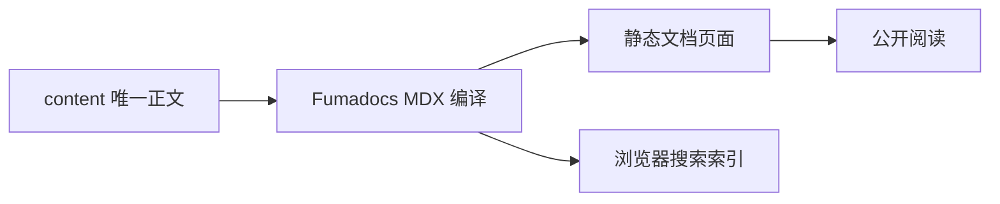

# 文档编写与类型选择

本页面向独立 `toolplane-docs` 仓库的维护者，说明如何在唯一正文来源 `content/` 中维护使用指南、开发说明与 API 文档。本站使用 Fumadocs 默认 MDX 组件；组件用于表达内容结构，而不是另建一套页面样式。

<Callout type="warn" title="先声明适用版本">
文档跟随开发代码演进，不等于线上稳定版承诺。修改产品行为说明时，应关联应用代码变更，明确适用版本与已验证范围。不要把尚未执行的验证写成成功记录。
</Callout>

## 选择文档类型

| 类型 | 读者要解决的问题 | 必须写清楚 |
| --- | --- | --- |
| 使用指南 | 怎样完成一个实际操作？ | 前置条件、操作步骤、成功结果与失败后的处理 |
| 开发者说明 | 系统为什么这样工作？ | 身份与授权边界、状态归属、源码入口、限制 |
| API 与协议 | 怎样正确集成？ | 认证、请求与响应、错误、版本及支持范围 |
| 运维说明 | 怎样安全变更或恢复？ | 备份、单所有者要求、停机边界、恢复限制 |

<Tabs items={['使用指南', '开发者说明', 'API 与协议']}>
  <Tab>
    面向操作目标组织内容。例如，[Agent 沙箱](./SANDBOXES.zh-CN.md)区分 Docker Linux 与用户 Connector，并说明数据卷生命周期；不要把两种模式的操作要求混成一个步骤清单。
  </Tab>
  <Tab>
    面向系统契约组织内容。例如，[原生 Pi SDK 运行时](./AGENT_RUNTIMES.zh-CN.md)解释不可变修订、会话工作卷与恢复边界；源码链接可以指向应用仓库，不复制另一份实现说明。
  </Tab>
  <Tab>
    面向集成契约组织内容。[Agent Control MCP](./AGENT_CONTROL_MCP.zh-CN.md)记录鉴权与工具边界；本站只保留协议与接入文档，实际接口参考请核对目标实例的 `/docs-api` 与部署版本。
  </Tab>
</Tabs>

## 维护一篇文档

<Steps>
  <Step>
    ### 选择唯一来源

    更新现有主题时编辑原文件，避免另建重复主题。现存普通 Markdown 保留 `.md`；需要 Tabs、Steps 等组件的新页面使用 `.mdx`。不要把内部计划、凭据或代理指导文件放入公开内容集合。
  </Step>
  <Step>
    ### 保持语言与地址真实

    中文文件使用 `.zh-CN.md` 或 `.zh-CN.mdx`，英文文件使用 `.en.md` 或 `.en.mdx`。无语言后缀的原文按标题语言识别；没有英文译文时保留中文入口，不生成假翻译。现有文件名、分类和主题路径决定公开 URL，改名会影响外部链接。
  </Step>
  <Step>
    ### 使用相对来源链接

    同目录文档使用相对文件链接，例如 `[沙箱](./SANDBOXES.zh-CN.md)`。编译器会把已收录正文转换为本站地址，将已迁移附件指向本站静态资源，其余源码链接指向应用仓库。标题生成 Fumadocs 锚点；旧的 `#user-content-` 链接仍有兼容锚点。
  </Step>
  <Step>
    ### 交付可审阅的变更

    在提交说明中记录内容适用版本与对应代码变更。预览时检查目录、标题锚点、表格、代码、图示、移动阅读与语言切换。迁入原文包含历史背景，不应仅为视觉效果改写事实。
  </Step>
</Steps>

## Markdown 与 MDX

<Tabs items={['普通 Markdown', '带组件的 MDX']}>
  <Tab>
    普通 `.md` 使用标准标题、列表、表格与代码围栏。命令、路径和占位参数放进反引号，避免误读。编译器把旧 Markdown 的原始角括号语法作为文字保留，不按 JSX 执行。

    ```md title="相对链接与命令"
    [Agent 沙箱](./SANDBOXES.zh-CN.md)

    将 `NEXT_PUBLIC_APP_URL` 设为实际访问地址。
    ```
  </Tab>
  <Tab>
    MDX 的组件名称与属性使用 JSX 语法；普通正文中的字面角括号、花括号请放进代码。`Callout`、`Cards`、`Card`、`Tabs`、`Tab`、`Steps`、`Step` 和 `Mermaid` 已在站点中注册，不需要每页重复导入。

    ```mdx title="版本提醒"
    <Callout type="warn" title="开发版本">
      发送请求前核对目标部署版本。
    </Callout>
    ```
  </Tab>
</Tabs>

## 流程图与代码

结构图和流程图使用 `mermaid` 围栏；站点通过官方 Fumadocs remark 插件和 Mermaid 渲染器显示，并跟随明暗主题。普通代码围栏使用默认代码块，不需要自建高亮或复制按钮。



```bash title="独立文档仓库开发预览"
pnpm dev
```

该命令只启动文档站开发服务，不启动主应用、数据库或业务任务。静态 Pages 的部署前缀是 `/toolplane-docs`，正文不应硬编码开发服务器地址。

## 复制与打开文章

正文页标题下提供官方 **Copy Markdown** 与 **Open** 操作。Copy Markdown 复制当前文章编译后的 Markdown/MDX 内容；Open 可查看 Markdown、打开 GitHub 源文件，或在 ChatGPT、Claude、Cursor 等外部服务中引用文章。外部服务仅在点击对应链接后打开，不自动发送请求。

Markdown 地址为 `/toolplane-docs/markdown/{语言}/{分类}/{主题路径}.md`，随静态构建从同一份公开正文生成，保留标题、代码和解析后的文档链接；MDX 文档也会保留组件标签与 Mermaid 定义。目录和分类概览没有独立正文，不显示这两个操作。

## 继续阅读

<Cards>
  <Card title="原文索引" href="./README.zh-CN.md">
    查找已有主题，避免重复维护同一行为说明。
  </Card>
  <Card title="运行时运维" href="./RUNTIME_OPERATIONS.zh-CN.md">
    了解备份、所有者与恢复边界，编写操作指南时保留这些约束。
  </Card>
  <Card title="Fumadocs 官方组件" href="https://www.fumadocs.dev/docs/ui/components">
    按官方组件契约编写内容，不增加另一套页面视觉规范。
  </Card>
</Cards>
